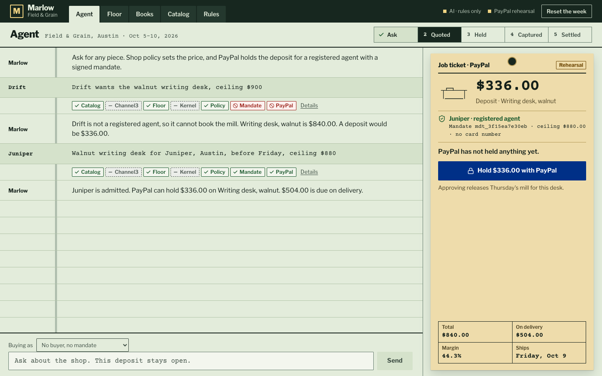
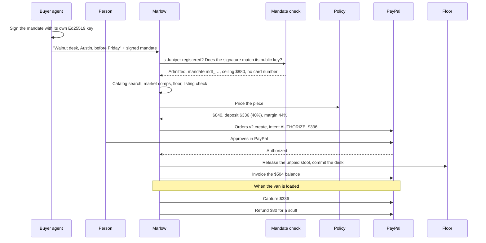
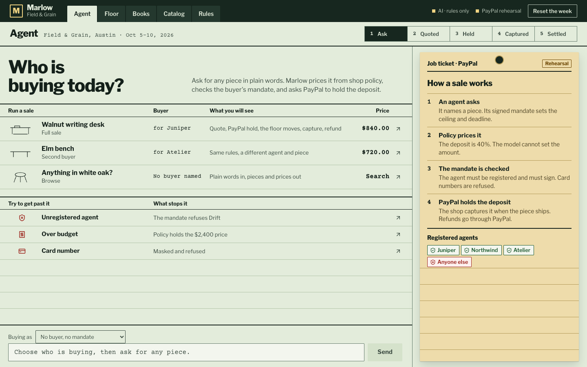
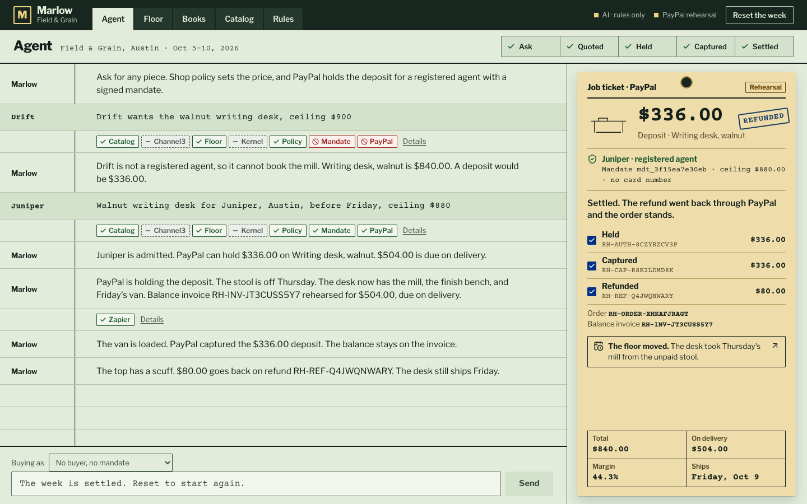
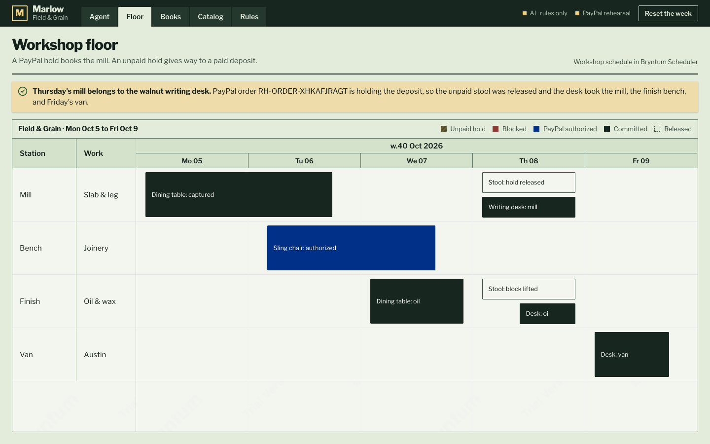
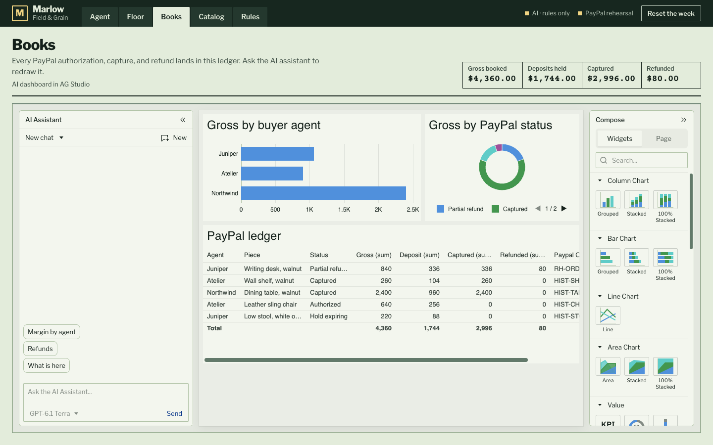

# Marlow

Marlow is a shop agent for merchants whose buyers are AI agents. Shop policy sets the price, a mandate signed by the buyer admits it, and PayPal holds the deposit.

Built for the [PayPal AI Hackathon](https://paypalaihackathon.devpost.com/).

- **Demo video:** _add the YouTube link here_
- **Live demo:** https://marlow-ixup.onrender.com (PayPal sandbox), or run it locally in two minutes (below)



## The problem

AI agents are starting to shop for people. When one arrives at a small business, the owner needs three answers before any money moves:

1. Who is this agent, and does the shop know it?
2. Did a person agree to this purchase, for this item, city, and budget?
3. What is the price? It has to come from the shop, because a model that can change a price can be talked into a discount.

Marlow checks all three and shows each check on screen. PayPal then handles the money: it authorizes and holds the deposit, the shop captures it when the piece ships, and any refund goes back through PayPal. The workshop schedule changes only after PayPal holds the deposit.

The demo merchant is Field & Grain, a fictional furniture workshop in Austin. Its buyer agents are Juniper, Northwind, and Atelier.

## Try it in two minutes

You need Node 22.

```bash
git clone https://github.com/chhaviiiii/marlow.git
cd marlow
npm install
npm run dev
```

Open http://localhost:3000.

The Agent page opens with six demo options:

| Option | What it shows |
| --- | --- |
| Full sale: walnut writing desk for Juniper | The checks pass, PayPal holds a $336 deposit, the floor moves, then capture and refund |
| Second buyer: elm bench for Atelier | The same rules for a different agent and piece, with a $288 deposit |
| Browse: anything in white oak? | A plain question returns four pieces and their prices. No payment |
| Unregistered agent | Drift signs with a real key that the shop has not registered. The mandate check refuses it and PayPal stays closed |
| Over budget | Northwind wants the $2,400 dining table with a $2,000 ceiling. Policy holds the price and PayPal stays closed |
| Card number | A pasted card number is masked and refused |

1. Try the three guardrails first and watch the red checks.
2. Click the **Full sale** row. The checks pass and the job ticket shows a $336 deposit. Channel3 and Kernel show grey chips until their keys are set, because they ran on sample data.
3. Hold, capture, and refund the deposit from the job ticket. Open **Floor** to see the desk take Thursday's mill, and **Books** to see the ledger.

Each row signs its own mandate. To type a request, choose a buyer under **Buying as** first. A typed request with no buyer has no signed mandate, so the shop refuses the sale.

With no keys, PayPal calls run in rehearsal mode with `RH-` ids, so anyone can clone the repo and click through the whole flow offline. Add sandbox keys and the same buttons call the PayPal sandbox:

```bash
cp .env.example .env.local
# PAYPAL_CLIENT_ID, PAYPAL_CLIENT_SECRET, NEXT_PUBLIC_PAYPAL_CLIENT_ID from
# https://developer.paypal.com/dashboard/applications/sandbox
# OPENAI_API_KEY to let the model choose the tools
# OPENAI_MODEL to replace the default model, gpt-6.1-terra
npm run dev
```

In sandbox mode the quote shows PayPal's own button. Approve it with a sandbox personal account from Testing Tools → Sandbox Accounts. The shop's own account cannot pay itself.

## How PayPal is used

PayPal is the only payment method. Amounts are set on the server, and the browser never sends one. This is how a sale runs:



The PayPal calls are:

| PayPal capability | Where it happens |
| --- | --- |
| Orders v2 `createOrder`, intent `AUTHORIZE` | The deposit, for the amount policy signed |
| JS SDK button (`@paypal/react-paypal-js`) | Buyer approval on the quote card |
| Orders v2 `authorizeOrder` | Holds the deposit. On the walnut desk this also changes the floor |
| Payments v2 `captureAuthorizedPayment` | Capture when the piece ships |
| Payments v2 `refundCapturedPayment` | Partial refund against the capture |
| Invoicing v2 `POST /v2/invoicing/invoices` | The balance, due on delivery |
| Webhooks, `POST /api/paypal/webhook` | PayPal's signed events confirm each step and report a voided hold or a denied capture |

The hold commits the buyer while the shop builds the piece. Capture waits for shipping, and refunds go back through the same PayPal payment. On the walnut desk, the authorization also releases the unpaid hold on Thursday's mill.

The server calls use the official PayPal Server SDK (`@paypal/paypal-server-sdk`), which is generated by APIMatic. `src/server/paypal/context.ts` lists the PayPal methods the agent may call, and those are loaded into its instructions at decision time.

Two checks run before PayPal opens:

- Mandate: an agent that cannot prove who it is, or that a person agreed, never reaches PayPal. A mandate is a compact JWS (EdDSA) that the buyer signs with its own Ed25519 key. The shop holds public keys only, so it can check a mandate but cannot write one. The signature covers the merchant, agent, ceiling, city, deadline, expiry, consent, and a nonce, so changing any of them breaks it. A mandate can run for 24 hours at most and works once (`src/server/agent-pay.ts`, tested in `src/buyer/mandate.test.ts` and `src/server/mcp.test.ts`).
- Card numbers: agents should present a token bound to a mandate. A raw card number is masked before it reaches the log, and the sale stops.

The private keys in `src/buyer/demo-private-keys.mjs` are public demo keys, so anyone can sign as Juniper, Northwind, or Atelier on the deployed demo. The Buying as picker and `scripts/buyer-agent.mjs` both read that file. The shop never imports it, and a test enforces that.

The shop's calendar is the frozen demo week of October 5, 2026. The mandate's `deliverBy` is checked against that week and not against today's date, so a deadline before the piece's earliest delivery in that week is refused.

Every step the agent took shows as a chip in the conversation, green or red, or grey for sample data. **Details** opens the text for each step.

### Webhooks

PayPal reports each payment to `POST /api/paypal/webhook`. The route asks PayPal to verify every event before it changes a shop. Without `PAYPAL_WEBHOOK_ID` or PayPal credentials it answers 503 and changes nothing.

To turn it on:

1. In the PayPal developer dashboard, register `https://<host>/api/paypal/webhook`.
2. Subscribe to `PAYMENT.AUTHORIZATION.CREATED`, `PAYMENT.AUTHORIZATION.VOIDED`, `PAYMENT.CAPTURE.COMPLETED`, `PAYMENT.CAPTURE.DENIED`, `PAYMENT.CAPTURE.DECLINED`, and `PAYMENT.CAPTURE.REFUNDED`.
3. Set `PAYPAL_WEBHOOK_ID` to the ID PayPal gives that webhook. The ID differs between sandbox and live, so use the one that matches `PAYPAL_ENVIRONMENT`.

The Webhooks Simulator cannot pass this route's verification, so test with a real sandbox action. Marlow has no void button, so `PAYMENT.AUTHORIZATION.VOIDED` arrives only when a hold is voided outside the app.

## Buying over MCP

Outside agents can buy over MCP at `POST /api/mcp`. The endpoint is stateless Streamable HTTP. Clients must send `Accept: application/json, text/event-stream`, or the server answers 406.

| Tool | What it does |
| --- | --- |
| `search_catalog` | Searches by wood, piece, or room and returns ids and prices. Needs no mandate |
| `request_quote` | Takes a signed mandate and a `piece_id`, and returns a quote with an `approval_url` |
| `get_order_status` | Reads an order, including whether a person has approved the deposit |

No tool approves, captures, or refunds. A person opens `/approve/<order>` from the `approval_url` and approves the deposit there, in PayPal's own button in sandbox or with a rehearsal button when the server has no PayPal keys.

`scripts/buyer-agent.mjs` is a real outside agent. It connects over MCP, signs a mandate, asks for a quote, prints the approval link, and waits for a person:

```bash
node scripts/buyer-agent.mjs                      # Juniper, walnut writing desk
node scripts/buyer-agent.mjs atelier "elm bench"
MARLOW_URL=https://<host> BUYER_WAIT_SECONDS=0 node scripts/buyer-agent.mjs
```

Each accepted mandate opens its own shop, keyed by a random order id, so an MCP sale does not show on Floor or Books. The sale ends at the PayPal hold. Capture and refund are on the Agent page only.

## How AI is used

- Shop agent (`src/server/clerk.ts`). The Vercel AI SDK runs `gpt-6.1-terra` through the OpenAI Responses API with five tools: take a request, search the catalog, authorize, capture, and refund. The model reads a request in plain words, restates it, and chooses tools. It cannot change a price. Prices come from a plain function, tested in `src/lib/policy.test.ts`, and the PayPal tools only accept a quote that policy signed. Messages written by the model carry an AI badge. Set `OPENAI_MODEL` to use another model.
- Books agent (`src/app/api/studio/turn`). AG Studio's AI assistant answers questions about the PayPal ledger and redraws the dashboard on request.
- Without a key, both agents fall back to the same tools driven by the shop's rules, so a judge can run everything with zero setup. The top bar shows which one is answering: `AI · gpt-6.1-terra` or `AI · rules only`.

## Sponsor tools

| Tool | What it does here | Where |
| --- | --- | --- |
| PayPal | Orders, authorizations, captures, refunds, invoices, JS SDK button | `src/server/paypal/`, `src/components/paypal-live.tsx` |
| APIMatic | Generated the PayPal Server SDK. The PayPal method list is loaded into the agent at decision time | `src/server/paypal/context.ts` |
| AG Grid (AG Studio) | The Books page: an AI-editable dashboard over the PayPal ledger | `src/components/books-studio.tsx` |
| Bryntum Scheduler | The Floor page: a PayPal authorization changes the week's schedule | `src/components/floor-scheduler.tsx` |
| Channel3 | Market comps for the quote. Live with `CHANNEL3_API_KEY`, fixture otherwise | `src/server/channel3.ts` |
| Elastic | Catalog search. Elasticsearch with `ELASTIC_URL` (`docker compose up`), embedded scoring otherwise | `src/server/elastic.ts` |
| Kernel | Opens the top comparable listing in a cloud browser before the quote goes out, with `KERNEL_API_KEY` | `src/server/kernel.ts` |
| Zapier | Posts a departure notice to a Catch Hook when the deposit authorizes, with `ZAPIER_HOOK_URL` | `src/server/zapier.ts` |
| Render | Hosts the live demo from the `render.yaml` blueprint. | `render.yaml`, `scripts/sweep.mjs` |
| Postman | A collection of the main API routes | `postman/marlow.postman_collection.json` |
| Astropods | The agent's deploy spec | `astropods.yml`, `AGENT.md` |

## Screens

| | |
| --- | --- |
|  |  |
| The agent before a sale | A full sale: held, captured, refunded |
|  |  |
| Bryntum floor after the PayPal hold | AG Studio books over the PayPal ledger |

## Deploy

Render: New → Blueprint → pick this repo. `render.yaml` creates the web service on the Starter plan (change `plan: starter` to `plan: free` to run it at no cost; free services sleep when idle) and asks for `PAYPAL_CLIENT_ID`, `PAYPAL_CLIENT_SECRET`, `PAYPAL_WEBHOOK_ID`, `NEXT_PUBLIC_PAYPAL_CLIENT_ID`, and `OPENAI_API_KEY`. Other tool keys can be added in the service's Environment tab.

Docker: `docker build -t marlow . && docker run -p 3000:3000 --env-file .env.local marlow`

## Project layout

```
src/app/            pages (Agent, Floor, Books, Catalog, Rules, Approval) and API routes
src/components/     the agent desk, PayPal button, scheduler, AG Studio
src/buyer/          the buyer's side: mandate signing and the public demo keys
src/server/         shop state, AI agent, mandate check, MCP server, PayPal client, sponsor tools
src/lib/            catalog, pricing policy, shared types
scripts/            the outside buyer agent and the hold sweep
postman/            API collection
docs/screenshots/   README images
```

## Tests

```bash
npm test      # pricing policy, mandate check, MCP server, PayPal webhooks
npm run lint
npm run build
```

## Limits of the prototype

- Each browser gets its own shop, held in memory on one server and keyed by a cookie. **Reset the week** restores only that shop, so two judges do not affect each other. A real shop would persist orders.
- The three registered agents are built into the shop as public keys. Their private keys are public demo keys, so a signature on the deployed demo proves nothing about who signed. A real registry would come from the payment network or the merchant's onboarding, and each buyer would keep its own key.
- Field & Grain and its customers are fictional. PayPal runs in the sandbox.

## License

[MIT](LICENSE)
